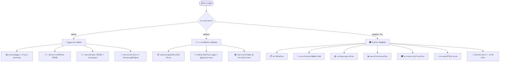

# BSRU Student Portal — คู่มือและเอกสารสรุปภาพรวมระบบ (System Documentation)

ระบบสารสนเทศนักศึกษา สาขาวิทยาการคอมพิวเตอร์ มหาวิทยาลัยราชภัฏบ้านสมเด็จเจ้าพระยา  
**BSRU Computer Science Student Portal & Information System**

---

## 1. ภาพรวมระบบ (System Overview)

ระบบ BSRU Student Portal ถูกพัฒนาขึ้นในรูปแบบ **Single Page Application (SPA)** ด้วยเทคโนโลยี **Vanilla JavaScript (ES6 Modules)**, **HTML5 Semantic**, และ **Modern Vanilla CSS** โดยไม่มีการพึ่งพา Framework ขนาดใหญ่ เพื่อให้โหลดได้รวดเร็ว ประสิทธิภาพสูง และรองรับการทำงานแบบ Dynamic State-Driven Architecture

### เทคโนโลยีหลักที่ใช้ (Tech Stack)
- **Frontend Core**: Vanilla JavaScript (ES6 Modules: `import` / `export`)
- **State Management**: Centralized Pub/Sub State Store (`js/state.js`)
- **CSS Architecture**: Modern CSS Variables (Design Tokens), Glassmorphism, CSS Grid & Flexbox
- **On-demand CSS Loader**: โหลดสไตล์เฉพาะ Role และ Component ตามการใช้งานจริง (`js/css-loader.js`)
- **Charts & Visualization**: Chart.js (Doughnut Chart) + Custom Pure CSS Progress Bars
- **AI Assistant**: Floating Chatbot Widget (`js/components/chatbot.js`)

---

## 2. โครงสร้างไฟล์และโฟลเดอร์ (Project Structure)

```
ChatbotCSBSRU/
├── index.html                     # โครงสร้างหลักของ SPA (Login, Sidebar, Main Modules, Modals)
├── DOCUMENTATION.md               # เอกสารสรุปภาพรวมระบบฉบับสมบูรณ์
├── assets/
│   └── images/                    # รูปภาพและโลโก้ประจำสาขาวิทยาการคอมพิวเตอร์ BSRU
├── css/
│   ├── main.css                   # ดีไซน์ซิสเต็ม ตัวแปรสี เลย์เอาต์ และคอมโพเนนต์พื้นฐาน
│   ├── components/                # สไตล์เฉพาะของแต่ละ Component (Loaded On-Demand)
│   │   ├── chatbot.css            # หน้าต่างและการโต้ตอบของ Floating Chatbot
│   │   ├── statusChart.css        # กราฟโดนัทแสดงสถานะนักศึกษา
│   │   ├── timetable.css          # ตารางเรียนแบบ Matrix Grid และ Mobile Agenda
│   │   └── petitions.css          # ฟอร์มยื่นคำร้อง, File Upload Zone, Toast, ตาราง Log
│   └── roles/                     # สไตล์เฉพาะของแต่ละบทบาทผู้ใช้งาน
│       ├── admin.css              # ธีมและลูกเล่นของผู้ดูแลระบบ (Red Accent)
│       ├── advisor.css            # ธีมของอาจารย์ที่ปรึกษา (Blue Accent)
│       └── student.css            # ธีมของนักศึกษา (Green Accent & Glow Effects)
└── js/
    ├── main.js                    # Entry Point หลัก, Navigation Config, Routing, Utility Helpers
    ├── auth.js                    # ระบบยืนยันตัวตน, Session Persist, และ Impersonation Mode
    ├── state.js                   # ตัวจัดการสถานะรวมของแอปพลิเคชัน (Pub/Sub State Store)
    ├── css-loader.js              # ตัวโหลด CSS แบบอะซิงโครนัสตามโมดูลที่เปิดใช้งาน
    ├── utils.js                   # ฟังก์ชันช่วยเหลือ เช่น Debounce, Formatting
    ├── components/
    │   ├── chatbot.js             # การทำงานของ Chatbot AI โต้ตอบอัตโนมัติ
    │   ├── statusChart.js         # ประมวลผลและวาด Chart.js สัดส่วนสถานะนักศึกษา
    │   └── careerList.js          # วิเคราะห์และแสดงสถิติเส้นทางอาชีพบัณฑิต
    └── roles/
        ├── admin.js               # หน้าแดชบอร์ด, จัดการอาจารย์, จัดการนักศึกษา, รายการคำร้อง
        ├── advisor.js             # หน้าแดชบอร์ดอาจารย์ และรายชื่อนักศึกษาในความดูแล
        └── student.js             # ประวัติ, ตารางเรียน, การเงิน, เกรด, ตรวจสอบจบ, กิจกรรม, ยื่นคำร้อง
```

---

## 3. ดีไซน์ซิสเต็มและอัตลักษณ์ (Design Tokens & Aesthetics)

ระบบได้รับการออกแบบตามอัตลักษณ์ของสาขาวิทยาการคอมพิวเตอร์ มหาวิทยาลัยราชภัฏบ้านสมเด็จเจ้าพระยา (CS BSRU):

| โทนสี / หมวดหมู่ | รหัสสี (HEX / CSS Variable) | การนำไปใช้งาน |
|---|---|---|
| **Deep Brand Blue** | `--brand-800: #102342`, `--brand-600: #1b3a6b` | แถบ Sidebar ด้านซ้าย, ปุ่ม Primary, หัวข้อหลัก |
| **Accent Circuit** | `--accent-400: #6baed4`, `--accent-500: #4a9ac8` | แถบเส้นขอบตกแต่ง, วงจร Glow, ลิงก์ย่อย |
| **Admin Theme** | `--red-500: #ef4444`, `--red-600: #dc2626` | แถบสีประจำแอดมิน, ปุ่มลบ, สถานะปฏิเสธ, Impersonation Banner |
| **Advisor Theme** | `--blue-500: #3b82f6`, `--blue-600: #2563eb` | แถบสีประจำอาจารย์ที่ปรึกษา, ข้อมูลบัณฑิต |
| **Student Theme** | `--green-500: #22c55e`, `--green-600: #16a34a` | แถบ Active Menu นศ., สถานะผ่าน/อนุมัติ/กำลังศึกษา |
| **Warning / Pending**| `--amber-500: #f59e0b`, `--amber-600: #d97706` | สถานะรอดำเนินการ, รอตรวจสอบ, ติดตามผล |
| **Background Body** | `--bg-body: #eef2f7`, `--bg-card: #ffffff` | พื้นหลังของระบบและกล่อง Card แสดงผล |

---

## 4. บทบาทผู้ใช้งานและฟังก์ชันการทำงาน (Role-Based Features)



---

### 4.1 บทบาทนักศึกษา (Student Role)
เข้าสู่ระบบด้วย Username ใดๆ เช่น `student` หรือรหัสนักศึกษา (เช่น `6421100042`)

1. **ประวัตินักศึกษา (Bibliography)** *(อัปเดตใหม่ — เปลี่ยนรูปโปรไฟล์ + แก้ไขข้อมูลพร้อมระบบตรวจสอบ)*:
   - แสดงข้อมูลส่วนตัว, รหัสนักศึกษา, คณะ, สาขา, ชั้นปี, อาจารย์ที่ปรึกษา, อีเมล, วันเกิด (แปลงเป็น พ.ศ. อัตโนมัติ), ศาสนา, ที่อยู่ พร้อม Stat Cards (GPA สะสม, หน่วยกิตสะสม)
   - **ฟังก์ชันเปลี่ยนรูปโปรไฟล์ (Profile Avatar Customization)** *(ใหม่)*:
     - อัปโหลดไฟล์รูปภาพจากเครื่อง (รองรับ JPG, PNG, WebP ขนาด $\le$ 2MB)
     - มีปุ่ม Overlay บนรูปภาพ และปุ่ม `📷 เปลี่ยนรูป` ทั้งในหน้าดูข้อมูลและในหน้าแก้ไขข้อมูลส่วนตัว พร้อมพรีวิวทันที
     - มีปุ่ม **"🗑️ ลบรูป" (Reset Avatar)** เพื่อรีเซ็ตกลับเป็นไอคอนมาตรฐาน
     - ซิงค์แสดงผลไปยัง Avatar ของ Topbar Header (`#topbarAvatar`) และบันทึกถาวรลงใน `localStorage`
   - **ปุ่ม "แก้ไขข้อมูลส่วนตัว"**: นักศึกษาสามารถสลับเข้าสู่โหมดแก้ไขเพื่อปรับปรุงข้อมูลตนเองได้ 6 ฟิลด์ พร้อมเงื่อนไขและการตรวจสอบความถูกต้อง:
     - **วันเกิด**: ปฏิทิน Date Picker (แปลงจัดเก็บและแสดงผลเป็น วัน เดือน ปี พ.ศ. เช่น `20 พ.ค. 2546`)
     - **หมายเลขโทรศัพท์**: จำกัด 10 หลัก บังคับเฉพาะตัวเลข 0-9 และขึ้นต้นด้วย `0`
     - **ชื่อ-สกุล (ภาษาไทย)**: ตรวจสอบต้องเป็นตัวอักษรภาษาไทยเท่านั้น
     - **ชื่อ-สกุล (English)**: ตรวจสอบต้องเป็นตัวอักษรภาษาอังกฤษ (A-Z, a-z) เท่านั้น
     - **ศาสนา**: เมนู Dropdown เลือกศาสนา (พุทธ, อิสลาม, คริสต์, ฮินดู, ซิกข์, อื่นๆ)
     - **ที่อยู่**: ช่องกรอกที่อยู่ปัจจุบัน
     - ขอบสีแดงเตือน (Real-time Red Border) และ Toast เตือนเมื่อกรอกผิดเงื่อนไข
   - ข้อมูลด้านวิชาการ (รหัสนักศึกษา, คณะ, สาขา, ชั้นปี, สถานภาพ, อาจารย์ที่ปรึกษา, ปีเข้าศึกษา) ถูกล็อกเป็น Read-only เพื่อความถูกต้องของข้อมูลจากระบบ
2. **ตารางเรียนและตารางสอบ (Timetable & Exam Schedule)** *(อัปเดตใหม่ — ลงข้อมูลเอง + ซิงค์สอบอัตโนมัติ)*:
   - **ระบบลงข้อมูลตารางเรียนด้วยตนเอง (Self-Enrollment)**:
     - ปุ่ม **"+ เพิ่มวิชาเรียน"** เปิดฟอร์มกรอกรหัสวิชา, ชื่อวิชา, วัน (จันทร์-อาทิตย์), เวลาเริ่ม-สิ้นสุด, ห้องเรียน, และชื่ออาจารย์ผู้สอน
     - **ระบบตรวจจับเวลาซ้อนทับ (Overlap Detection)**: ป้องกันไม่ให้นักศึกษาลงวิชาที่มีช่วงเวลาทับซ้อนกันในวันเดียวกัน
     - ตารางเรียน Matrix Grid และ Mobile Agenda View จะคำนวณและวาดบล็อครายวิชาใหม่ลงตารางโดยอัตโนมัติ
     - **ปุ่มลบวิชา (✕)**: สามารถกดลบวิชาที่ไม่ต้องการออกจากตารางเรียนได้ทั้งในมุมมอง Desktop และ Mobile
   - **ระบบตารางสอบอัตโนมัติ (Automated Exam Schedule)**:
     - ตารางสอบจะแสดงผล **เฉพาะวิชาที่อาจารย์ผู้สอนได้ประกาศสอบไว้** และ **ตรงกับรหัสวิชาที่นักศึกษาลงทะเบียนเรียน** ในตารางเรียนเท่านั้น
     - หากวิชาใดยังไม่มีการประกาศสอบ หรือนักศึกษาไม่ได้ลงทะเบียนเรียนวิชานั้น จะไม่ปรากฏในตารางสอบ
3. **การเงินและทุนการศึกษา (Finance & Scholarships)**:
   - ยอดค้างชำระ, ยอดชำระแล้วทั้งหมด
   - ข้อมูลทุนการศึกษา (เช่น ทุน กยศ.)
   - ตารางประวัติการชำระเงินรายภาคเรียนพร้อม Badge แสดงสถานะ
4. **ผลการเรียน (Studied Result / Grades)**:
   - เลือกดูเกรดแยกตามภาคเรียนพร้อมคำนวณ GPA รายเทอม
   - ตารางแสดงรหัสวิชา, ชื่อวิชา, หน่วยกิต, เกรดตัวอักษร, และค่าคะแนน
5. **ตรวจสอบจบ (Graduation Audit)** *(อัปเดตใหม่ — ตารางตรวจสอบจบตามเกณฑ์หลักสูตรแบบสมบูรณ์ + Responsive Switcher)*:
   - **ระบบปุ่มสลับมุมมอง (View Switcher Toolbar)** *(ใหม่)*:
     - **📊 ตารางเต็ม (Table View)**: แสดงตาราง Matrix วิชาทั้งหมด 8 เทอม ตรึงคอลัมน์ชื่อวิชา (Sticky Subject Column) เมื่อเลื่อนแนวนอนบนหน้าจอมือถือ/แท็บเล็ต พร้อมแถบ Scroll Hint
     - **📱 การ์ดสรุปบนมือถือ (Mobile Cards View)**: แสดงผลแบบ Accordion Card แยกตามหมวด/กลุ่มวิชา พร้อมการ์ดรายวิชาแต่ละตัว เกรดแบบ Academic Navy และคะแนน CA/PT/AVG/MAX ครบถ้วน
   - **ระบบประเมินเงื่อนไขการสำเร็จการศึกษา (Graduation Requirements Audit)**:
     - แสดงการตรวจสอบรายวิชาตามโครงสร้างหลักสูตร 4 หมวดวิชาหลัก:
       1. **หมวดวิชาศึกษาทั่วไป**:
          - วิชาศึกษาทั่วไปบังคับ (`MIN 20 CR`)
          - **วิชาศึกษาทั่วไปเลือก 3 วิชาจาก 5 กลุ่ม (`MIN 9 CR`)**: มีระบบตรวจสอบเงื่อนไขเฉพาะว่าต้องเลือกเรียนจากกลุ่มวิชาที่แตกต่างกันอย่างน้อย 3 กลุ่ม (จาก 5 กลุ่ม) และเลือกได้กลุ่มละไม่เกิน 1 วิชา พร้อมแสดงสถานะสรุป `PASS 9 CR (3/3 กลุ่ม)`
          - วิชาศึกษาทั่วไปบังคับเลือก (`MIN 1 CR`)
       2. **หมวดวิชาเฉพาะ**: วิชาแกน (`MIN 18 CR`), วิชาเฉพาะด้านบังคับ 5 กลุ่ม (`MIN 45 CR`), วิชาเฉพาะด้านเลือก (`MIN 21 CR` / `FAIL 15 CR`), วิชาพื้นฐานวิชาชีพ (โครงงานและฝึกประสบการณ์วิชาชีพ `MIN 7 CR` / `FAIL 1 CR`)
       3. **หมวดวิชาเลือกเสรี**: (`MIN 6 CR` / `PASS 6 CR`)
       4. **กลุ่มทักษะความรู้ความสามารถ**: วัดสมิทธิภาพภาษาอังกฤษ (CEFR) และทักษะความเข้าใจดิจิทัล (DL)
     - **UI ดีไซน์สบายตา ไม่ลายตา (Clean & Modern Aesthetic Table)**:
       - **ป้ายสถานะ `[PASS]`**: สีเขียวมรกต (Emerald Green) คมชัด อ่านง่าย
       - **แท็กผลการเรียนในตาราง (เกรดเทอม 1-8)**: ใช้โทนสี **Academic Navy / Slate Blue** (พื้นหลัง `#eff6ff` ตัวอักษรสีน้ำเงินเข้ม `#1e40af` ขอบ `#bfdbfe`) ดูเป็นทางการ สวยงาม และสบายตา
       - **วิชาที่รอผล/ลงทะเบียน (`--`)**: ใช้โทนสี Slate Gray สุภาพและชัดเจน
       - จัดระเบียบเส้นตารางแบบ Minimal Horizontal Dividers ไร้เส้นตารางแนวตั้งที่รกรุงรัง และกำจัดหัวข้อแถวซ้ำซ้อนในกลุ่มวิชาย่อยอย่างสมบูรณ์
     - **ระบบตารางเมทริกซ์ผลการเรียนรายเทอม (Semesters 1 - 8)**:
       - แสดงผลการเรียนรายวิชาในแต่ละภาคเรียน (เช่น `A 1/66`, `B+ 1/68`, `-- 1/69` สำหรับวิชาที่รอผล)
       - แสดงข้อมูลหน่วยกิตโครงสร้าง (เช่น `3(3-0-6)`), หน่วยกิตลงทะเบียน (CA), คะแนนรวม (PT), ค่าเฉลี่ย (AVG), เกรดสูงสุด (MAX)
       - มี Badge แสดงสถานะกลุ่มวิชา `[PASS]` / `[FAIL]`, หน่วยกิตขั้นต่ำ `MIN XX CR`, หน่วยกิตที่ผ่าน `PASS XX CR`, และ `GPA X.XX`
     - **ระบบ Accordion (ยุบ/ขยาย)**:
       - สามารถคลิกที่แถบหัวข้อหมวดวิชาเพื่อยุบหรือขยายเนื้อหา หรือกดปุ่ม **"▾ ขยายทุกหมวด"** / **"▴ ยุบทุกหมวด"** ได้อย่างสะดวกรวดเร็ว
     - **แถบสรุปสถานะและความคืบหน้าภาพรวม**:
       - สรุปเปอร์เซ็นต์หน่วยกิตสะสมรวม (`96/132 CR` = 73%), GPA สะสม (เกณฑ์ขั้นต่ำ ≥ 2.00), จำนวนหมวดที่ผ่านเกณฑ์ (8/11 หมวด), และกล่องแจ้งเตือนรายการที่ต้องดำเนินการเพิ่มเติมเพื่อสำเร็จการศึกษา
6. **กิจกรรม (Activity Check)**:
   - สรุปชั่วโมงกิจกรรมสะสม, จำนวนกิจกรรมที่ผ่านแล้ว
   - การ์ดรายการกิจกรรม (วิชาการ, จิตอาสา, กีฬา, มหาวิทยาลัย)
7. **ยื่นคำร้องวิชาการ (Academic Petitions)**:
   - **ฟอร์มยื่นคำร้อง**:
     - ประเภทคำร้อง (ยื่นขอสอบหัวข้อโปรเจคจบ / ยื่นสอบจบปริญญานิพนธ์ / คำร้องทั่วไป)
     - ชื่อหัวข้อ / Project Title
     - รายละเอียดเพิ่มเติมและเหตุผลประกอบ
     - แนบไฟล์เอกสาร (รองรับเฉพาะไฟล์ `.pdf` สูงสุด 10MB มีระบบ Drag & Drop และแสดงชื่อไฟล์พร้อมปุ่มลบ)
     - ปุ่มส่งคำร้องพร้อม Loading State และ Toast Notification แจ้งผล
   - **ประวัติคำร้องของตนเอง**: การ์ดแสดงรายการคำร้องที่เคยยื่น, วันที่ยื่น, สถานะ (อนุมัติ / รอดำเนินการ / ปฏิเสธ), เอกสารแนบ และความเห็นตอบกลับจากแอดมิน

---

### 4.2 บทบาทอาจารย์ที่ปรึกษา (Advisor Role)
เข้าสู่ระบบด้วย Username: `advisor`

1. **แดชบอร์ดอาจารย์ (Advisor Dashboard)**: สรุปภาพรวมจำนวนนักศึกษาในความดูแล, สัดส่วนสถานะนักศึกษา, ค่าเฉลี่ย GPA
2. **นักศึกษาในที่ปรึกษา (My Advisees)**:
   - รายชื่อนักศึกษาในความดูแลพร้อมรูปโปรไฟล์และข้อมูลติดต่อ
   - ปุ่ม **"จำลอง" (Impersonate View)** เพื่อจำลองมุมมองเข้าไปดูหน้าพอร์ทัลเสมือนเป็นนักศึกษาคนนั้นได้ทันที
3. **จัดการรายวิชา & ประกาศสอบ (Course Management & Exam Announcements)** *(โมดูลใหม่)*:
   - **จัดการรายวิชาที่สอน (My Courses)**: อาจารย์สามารถเพิ่มรายวิชาที่ตนเองรับผิดชอบสอน (รหัสวิชา, ชื่อวิชา EN/TH) และลบรายวิชาได้
   - **ประกาศตารางสอบ (Exam Announcements)**: อาจารย์สามารถเลือกรายวิชาที่สอน ระบุวันสอบ, เวลาเริ่ม-สิ้นสุด, และห้องสอบ เพื่อทำการประกาศสอบ
   - ข้อมูลประกาศสอบจะถูกเชื่อมโยงและนำไปแสดงผลบนหน้าตารางสอบของนักศึกษาทุกคนที่ลงทะเบียนเรียนวิชานั้นแบบเรียลไทม์โดยอัตโนมัติ

---

### 4.3 บทบาทผู้ดูแลระบบ (Admin Role)
เข้าสู่ระบบด้วย Username: `admin`

1. **แดชบอร์ดผู้ดูแล (Admin Dashboard)**:
   - **ตัวกรองดูข้อมูลแยกตาม "รุ่น / ปีที่เข้าศึกษา" (Batch / Admit Year)**: เลือกดูข้อมูลนักศึกษาได้ทั้งแบบ "ทุกรุ่น" หรือเจาะจงเฉพาะรุ่น (เช่น รุ่น 66, 65, 64, 63, 62, 61)
   - **Stat Cards คำนวณแบบ Real-time**: จำนวนอาจารย์ที่ปรึกษา, จำนวนนักศึกษาในรุ่น, กำลังศึกษา, จบการศึกษา, พักการศึกษา/พ้นสภาพ
   - **Status Donut Chart**: กราฟสัดส่วนสถานภาพนักศึกษา ปรับเปลี่ยนข้อมูลตามรุ่นที่เลือก
   - **Career Data List**: รายการสถิติสายอาชีพของบัณฑิตที่สำเร็จการศึกษา
2. **จัดการอาจารย์ที่ปรึกษา (Manage Advisors)**:
   - รายชื่ออาจารย์, อีเมล, สาขา, จำนวนนักศึกษาที่ดูแล
   - การทำงานแบบ CRUD (เพิ่มอาจารย์ใหม่, แก้ไขข้อมูล, ลบข้อมูล) ผ่าน Modal Dialog
3. **จัดการนักศึกษา (Manage Students)**:
   - ตารางรายชื่อนักศึกษาทั้งหมด พร้อมตัวกรองตามรุ่น และช่องค้นหาแบบ Real-time (Debounced Search)
   - CRUD จัดการข้อมูลนักศึกษา (เพิ่ม, แก้ไข, ลบ)
   - **ระบบจำลองมุมมอง (Impersonation Mode)**: กดปุ่ม "จำลอง" เพื่อดูข้อมูลในฐานะนักศึกษาคนนั้น พร้อมแถบสีแดงด้านบนสำหรับกดออกจากการจำลอง
4. **รายการคำร้องวิชาการ (Petition Logs)** *(โมดูลใหม่)*:
   - **Stat Cards สรุปยอดคำร้อง**: ทั้งหมด, รอดำเนินการ, อนุมัติแล้ว, ปฏิเสธ
   - **แถบตัวกรองหลายมิติ**:
     - กรองตามรุ่นของนักศึกษา (ทุกรุ่น, รุ่น 66, รุ่น 65, ...)
     - กรองตามประเภทคำร้อง (หัวข้อโปรเจค, สอบจบ, คำร้องทั่วไป)
     - กรองตามสถานะ (ทุกสถานะ, รอดำเนินการ, อนุมัติ, ปฏิเสธ)
     - ช่องค้นหาแบบ Real-time (ค้นหาด้วยรหัสคำร้อง, รหัสนักศึกษา, ชื่อนักศึกษา, ชื่อหัวข้อ)
   - **ตาราง Log คำร้อง**: แสดงรหัสคำร้อง, วันเวลาที่ยื่น, ข้อมูลนักศึกษา, ประเภท, ชื่อเรื่อง, สัญลักษณ์ไฟล์แนบ PDF, สถานะ
   - **Modal ดูรายละเอียดและพิจารณาคำร้อง**: เปิดดูข้อมูลคำร้องฉบับเต็ม, ลิงก์จำลองเปิดไฟล์ PDF, ปรับเปลี่ยนสถานะคำร้อง (อนุมัติ / ปฏิเสธ / รอดำเนินการ) พร้อมพิมพ์หมายเหตุหรือความเห็นประกอบ บันทึกแล้วข้อมูลจะเชื่อมโยงไปแสดงที่หน้าของนักศึกษาทันที

---

## 5. แผนผังและโครงสร้างโมเดลข้อมูล (Data Models)

### 5.1 ข้อมูลคำร้องวิชาการ (`MOCK_PETITIONS_LOG`)
```javascript
{
    id: "PET-2567-001",                           // รหัสคำร้องเฉพาะ
    studentId: "6421100042",                      // รหัสนักศึกษาผู้ยื่น
    studentName: "สมชาย ใจดี",                     // ชื่อ-สกุลนักศึกษา
    type: "ยื่นขอสอบหัวข้อโปรเจคจบ",                 // ประเภทคำร้อง
    title: "ระบบจัดการข้อมูลนักศึกษาด้วย AI Chatbot", // ชื่อหัวข้อโปรเจค / เรื่อง
    details: "ขอยื่นสอบหัวข้อโปรเจคจบ...",           // รายละเอียด / เหตุผล
    attachment: "proposal_6421100042.pdf",        // ชื่อไฟล์เอกสารแนบ (.pdf)
    submittedAt: "15 ม.ค. 2567 10:30",            // วันที่และเวลาที่ยื่นคำร้อง
    status: "อนุมัติ",                             // 'รอดำเนินการ' | 'อนุมัติ' | 'ปฏิเสธ'
    adminComment: "เอกสารครบถ้วน อนุมัติให้สอบได้"     // ความเห็น / หมายเหตุจากแอดมิน
}
```

### 5.2 ข้อมูลนักศึกษา (`MOCK_STUDENTS_POOL`)
```javascript
{
    studentId: "6421100042",                      // รหัสนักศึกษา 10 หลัก
    nameTh: "สมชาย ใจดี",                          // ชื่อภาษาไทย
    nameEn: "Somchai Jaidee",                     // ชื่อภาษาอังกฤษ
    year: 3,                                      // ชั้นปีปัจจุบัน (1 - 6)
    gpa: 3.42,                                    // เกรดเฉลี่ยสะสม
    status: "กำลังศึกษา",                          // 'กำลังศึกษา' | 'จบการศึกษา' | 'พักการศึกษา' | 'พ้นสภาพ'
    advisor: "ADV001",                            // รหัสอาจารย์ที่ปรึกษา
    careerPath: "Full-Stack Developer"            // สายอาชีพ (สำหรับผู้ที่จบการศึกษา)
}
```

### 5.3 ข้อมูลอาจารย์ที่ปรึกษา (`MOCK_ADVISORS`)
```javascript
{
    id: "ADV001",                                 // รหัสประจำตัวอาจารย์
    nameTh: "ผศ.ดร.วิชัย เทคโนโลยี",                // ชื่อภาษาไทย
    nameEn: "Asst.Prof.Dr. Wichai Technology",    // ชื่อภาษาอังกฤษ
    email: "wichai.t@bsru.ac.th",                 // อีเมลติดต่อ
    phone: "02-473-7000 ต่อ 4001",                 // เบอร์โทรศัพท์
    department: "วิทยาการคอมพิวเตอร์",              // สาขาวิชา
    studentsCount: 12                             // จำนวนนักศึกษาในความดูแล
}
```

---

## 6. ฟังก์ชันอำนวยความสะดวกและระบบความปลอดภัย (Security & Utilities)

1. **ระบบจำลองสิทธิ์นักศึกษา (Impersonation Mode)**:
   - ผู้ดูแลระบบ (Admin) และอาจารย์ (Advisor) สามารถกดสลับไปดูหน้าพอร์ทัลในมุมมองของนักศึกษาเป้าหมายได้ทันที
   - ระบบจะแสดงแถบแบนเนอร์สีแดงเด่นชัดด้านบน (`#impersonationBanner`) เพื่อเตือนว่ากำลังอยู่ในโหมดจำลองสิทธิ์ พร้อมปุ่มกดออก
2. **ระบบป้องกัน Cross-Site Scripting (XSS Prevention)**:
   - ฟังก์ชัน `esc(str)` ทำการแปลง String ให้อยู่ในรูปแบบ HTML Safe Text ก่อนเรนเดอร์ลงใน DOM เสมอ
3. **ระบบตัดคำและค้นหาประสิทธิภาพสูง (Debounce Search)**:
   - ฟังก์ชัน `debounce(fn, 300)` ช่วยชะลอการเรียกฟังก์ชันค้นหาขณะผู้ใช้กำลังพิมพ์ เพื่อลดการประมวลผล DOM ซ้ำซ้อน
4. **Pub/Sub Centralized State (`state.js`)**:
   - ควบคุมการเปลี่ยนหน้าโมดูล (`activeModule`), บทบาท (`currentRole`), และจดจำ Session ใน `sessionStorage` เพื่อคงสถานะเมื่อกดรีเฟรชหน้าเว็บ

---

## 7. ข้อมูลการทดสอบระบบ (Credentials & Testing Guide)

| บทบาท (Role) | Username สำหรับ Login | รหัสผ่าน (Password) | วัตถุประสงค์ในการทดสอบ |
|---|---|---|---|
| **Admin** | `admin` | อะไรก็ได้ (เช่น `1234`) | ทดสอบแดชบอร์ดกรองตามปี, จัดการอาจารย์/นักศึกษา, และพิจารณา Log คำร้องวิชาการ |
| **Advisor** | `advisor` | อะไรก็ได้ (เช่น `1234`) | ทดสอบดูนักศึกษาในที่ปรึกษา และการจำลองมุมมองดูข้อมูลนักศึกษา |
| **Student** | `student` หรือ รหัสนักศึกษา | อะไรก็ได้ (เช่น `1234`) | ทดสอบดูตารางเรียน, ผลการเรียน, ตรวจสอบจบ, และยื่นคำร้องวิชาการใหม่ |

---
*เอกสารนี้จัดทำขึ้นโดยครอบคลุมโครงสร้างและฟังก์ชันทั้งหมดของระบบ BSRU Student Portal*
