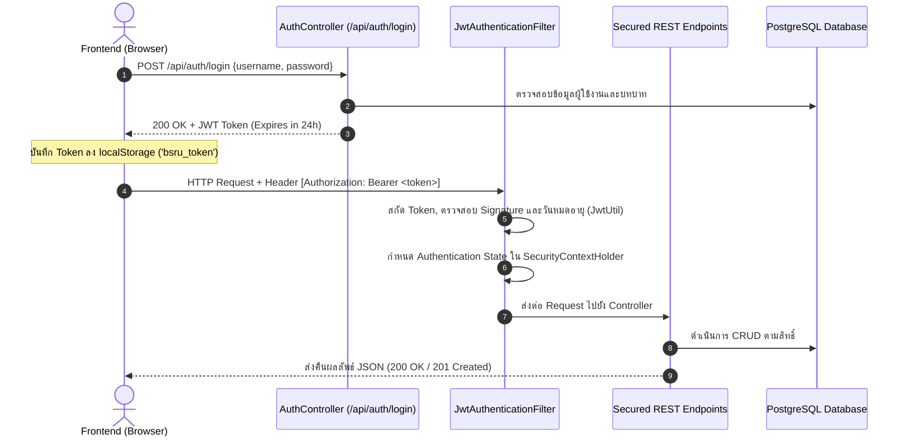
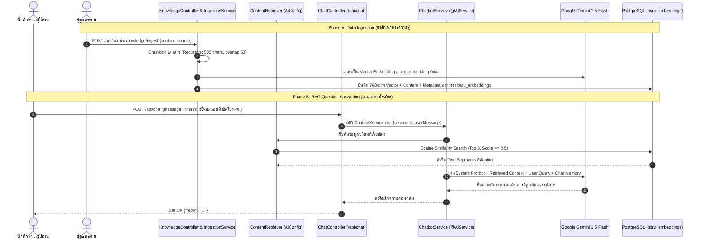

# 📑 BSRU Student Portal & AI Chatbot — เอกสารสถาปัตยกรรมระบบและข้อมูลเชิงเทคนิค (Technical Documentation)

ระบบสารสนเทศนักศึกษาและปัญญาประดิษฐ์ให้คำปรึกษาทางวิชาการ (RAG Pipeline)  
สาขาวิชาวิทยาการคอมพิวเตอร์ คณะวิทยาศาสตร์และเทคโนโลยี มหาวิทยาลัยราชภัฏบ้านสมเด็จเจ้าพระยา  
**BSRU Computer Science Student Portal, REST API & Generative AI Assistant System**

> **🎯 วัตถุประสงค์ของเอกสารนี้:**  
> เอกสารฉบับนี้มีหน้าที่เป็น **เอกสารสถาปัตยกรรมและข้อกำหนดเชิงเทคนิคฉบับสมบูรณ์ (Technical Architecture & Developer Specs)** สำหรับ **นักพัฒนาซอฟต์แวร์ (Developers), วิศวกรระบบ (System Engineers) และผู้ประเมินเชิงเทคนิค** โดยรวบรวมรายละเอียดสถาปัตยกรรม Full-Stack, วงจรความปลอดภัย Spring Security 6 + JWT, ระบบ LangChain4j RAG Pipeline, รายละเอียด REST API Endpoints ทุกเส้นทาง และโครงสร้างฐานข้อมูล DDL Schema  
> 🔗 *ย้อนกลับไปหน้าแรก: [README.md](README.md) | คู่มือการติดตั้งและทดสอบฟังก์ชัน: [USER_GUIDE.md](USER_GUIDE.md)*

---

## 1. ภาพรวมระบบ (System Overview)

ระบบ **BSRU Student Portal & AI Chatbot** ได้รับการออกแบบและพัฒนาในรูปแบบ **Full-Stack Enterprise Architecture** เพื่อเป็นศูนย์กลางการให้บริการข้อมูลทางวิชาการ การจัดการข้อมูลนักศึกษา และการให้คำปรึกษาอัตโนมัติด้วยปัญญาประดิษฐ์ (Generative AI)

```
┌─────────────────────────────────────────────────────────────────────────────────────────────┐
│                                   CLIENT LAYER (Browser)                                    │
│   Single Page Application (SPA) — Vanilla JS (ES6 Modules) + Modern CSS Design System       │
│   [Student Portal]  [Advisor Portal]  [Admin Portal]  [Interactive Floating AI Chatbot]     │
└──────────────────────────────────────────────┬──────────────────────────────────────────────┘
                                               │ HTTP / REST API (JSON + JWT Bearer Token)
                                               ▼
┌─────────────────────────────────────────────────────────────────────────────────────────────┐
│                               BACKEND LAYER (Spring Boot 3.3.4)                             │
│   • Spring Security 6: JWT Authentication Filter, Stateless Sessions, Strict CORS Source    │
│   • Spring Data JPA & Hibernate ORM: Student, Advisor, AcademicPetition Entities            │
│   • LangChain4j 0.35.0 AI & RAG Engine:                                                     │
│     - Google Gemini 1.5 Flash (Generative Chat Model)                                       │
│     - Gemini text-embedding-004 (768-Dimension Embedding Model)                             │
│     - ContentRetriever (Cosine Similarity Search >= 0.7, Top 3 Chunks)                      │
│     - MessageWindowChatMemory (Stateful Multi-turn Session Window: 20 messages)             │
└──────────────────────────────────────────────┬──────────────────────────────────────────────┘
                                               │ PostgreSQL Wire Protocol (Port 5432)
                                               ▼
┌─────────────────────────────────────────────────────────────────────────────────────────────┐
│                       DATABASE & VECTOR LAYER (Docker: PostgreSQL 16)                       │
│   Container: `bsru_vector_db` (Image: pgvector/pgvector:pg16)                               │
│   • Relational Tables: `students`, `advisors`, `academic_petitions`                         │
│   • Vector Table: `bsru_embeddings` (768-dim Vectors + HNSW Index + JSON Metadata)          │
│   • Persistent Volume: `pg_data`                                                            │
└─────────────────────────────────────────────────────────────────────────────────────────────┘
```

### เทคโนโลยีหลักที่ใช้ (Technology Stack)
- **Frontend Layer**: Vanilla JavaScript (ES6 Modules: `import` / `export`), Semantic HTML5, Vanilla CSS (CSS Variables, Glassmorphism, CSS Grid & Flexbox, Dynamic On-demand CSS Loader)
- **Backend Framework**: Spring Boot 3.3.4 (Java 21 LTS), Maven 3.9.9
- **Security Framework**: Spring Security 6, JJWT (Java JSON Web Token 0.12.6), BCrypt Password Encryption
- **AI & RAG Engine**: LangChain4j 0.35.0, Google AI Gemini 1.5 Flash, Gemini `text-embedding-004`
- **Database & Vector Store**: PostgreSQL 16 + pgvector 0.8.6 Containerized with Docker Compose

---

## 2. โครงสร้างไฟล์และโฟลเดอร์ของโปรเจกต์ (Project Directory Tree)

```
ChatbotCSBSRU/
├── .env.example                           # ไฟล์แม่แบบตัวแปรสภาพแวดล้อม (Template Environment)
├── .env                                   # ค่าจริง Environment Variables (ไม่ commit ใน Git)
├── start-backend.bat                      # สคริปต์สตาร์ท Backend สำหรับ Windows CMD (อ่าน .env อัตโนมัติ)
├── start-backend.ps1                      # สคริปต์สตาร์ท Backend สำหรับ PowerShell (อ่าน .env อัตโนมัติ)
├── docker-compose.yml                     # คอนฟิกูเรชัน Docker PostgreSQL 16 + pgvector
├── init.sql                               # สคริปต์เปิดใช้งานส่วนขยาย CREATE EXTENSION vector;
├── pom.xml                                # Maven Dependencies (Spring Boot, Security, JJWT, LangChain4j, Postgres)
├── README.md                              # เอกสารแนะนำโปรเจกต์และเริ่มต้นใช้งานด่วน (Quick Start)
├── USER_GUIDE.md                          # คู่มือขั้นตอนการติดตั้งและทดสอบฟังก์ชันระบบฉบับละเอียด
├── DOCUMENTATION.md                       # เอกสารสรุปภาพรวมและคู่มือสถาปัตยกรรมระบบฉบับสมบูรณ์
├── index.html                             # หน้าเว็บหลัก SPA (Login, Sidebar, Main Modules, Modals, Chatbot)
├── assets/
│   └── images/                            # รูปภาพ โลโก้สาขาวิชา และตรามหาวิทยาลัย BSRU
├── css/
│   ├── main.css                           # ดีไซน์ซิสเต็ม ตัวแปรสี เลย์เอาต์ แถบเมนู Toast และสไตล์พื้นฐาน
│   ├── components/                        # สไตล์เฉพาะของแต่ละ Component (Loaded On-Demand)
│   │   ├── chatbot.css                    # หน้าต่างและการโต้ตอบของ Floating AI Chatbot Widget (Responsive)
│   │   ├── statusChart.css                # กราฟโดนัทแสดงสถิติสถานะนักศึกษา (Chart.js)
│   │   ├── timetable.css                  # ตารางเรียนแบบ Matrix Grid และ Mobile Agenda
│   │   └── petitions.css                  # ฟอร์มยื่นคำร้อง, Drag & Drop Upload, ตาราง Log คำร้อง
│   └── roles/                             # สไตล์เฉพาะของแต่ละบทบาทผู้ใช้งาน
│       ├── admin.css                      # ธีมและลูกเล่นของผู้ดูแลระบบ (Red Accent)
│       ├── advisor.css                    # ธีมของอาจารย์ที่ปรึกษา (Blue Accent)
│       └── student.css                    # ธีมของนักศึกษา (Green Accent & Glow Effects)
├── js/
│   ├── main.js                            # Entry Point หลัก, Navigation Config, Routing, Utility Helpers
│   ├── api.js                             # REST API Client Utility (Auto JWT Bearer Token Injection)
│   ├── auth.js                            # ระบบยืนยันตัวตน, Session Persist, และ Impersonation Mode
│   ├── state.js                           # ตัวจัดการสถานะรวมของแอปพลิเคชัน (Pub/Sub Centralized State Store)
│   ├── css-loader.js                      # ตัวโหลด CSS แบบอะซิงโครนัสตามโมดูลที่เปิดใช้งาน
│   ├── utils.js                           # ฟังก์ชันช่วยเหลือสากล เช่น Debounce, Toast Notifications
│   ├── components/
│   │   ├── chatbot.js                     # การทำงานของ AI Chatbot โต้ตอบแบบเรียลไทม์ผ่าน REST API
│   │   ├── statusChart.js                 # ประมวลผลและวาด Chart.js สัดส่วนสถานะนักศึกษา
│   │   └── careerList.js                  # วิเคราะห์และแสดงสถิติเส้นทางอาชีพบัณฑิต
│   └── roles/
│       ├── admin.js                       # หน้าแดชบอร์ด, จัดการอาจารย์, จัดการนักศึกษา, พิจารณาคำร้อง
│       ├── advisor.js                     # หน้าแดชบอร์ดอาจารย์, นักศึกษาในที่ปรึกษา, ประกาศตารางสอบ
│       └── student.js                     # ประวัติ, ตารางเรียน, การเงิน, เกรด, ตรวจสอบจบ, กิจกรรม, ยื่นคำร้อง
└── src/
    └── main/
        ├── java/com/bsru/studentportal/
        │   ├── BsruStudentPortalApplication.java # Spring Boot Application Main Class
        │   ├── config/
        │   │   ├── CorsConfig.java               # Global Spring MVC CORS Config
        │   │   ├── SecurityConfig.java           # Spring Security 6 FilterChain, Stateless Session & CORS
        │   │   └── AiConfig.java                 # LangChain4j Gemini Models, PGVector Store & ContentRetriever
        │   ├── security/
        │   │   ├── JwtUtil.java                  # การสร้าง ถอดรหัส และตรวจสอบความถูกต้องของ JWT Token
        │   │   └── JwtAuthenticationFilter.java  # OncePerRequestFilter ดักจับและยืนยัน Bearer Token
        │   ├── model/
        │   │   ├── Student.java                  # JPA Entity: ตาราง students
        │   │   ├── Advisor.java                  # JPA Entity: ตาราง advisors
        │   │   └── AcademicPetition.java         # JPA Entity: ตาราง academic_petitions
        │   ├── repository/
        │   │   ├── StudentRepository.java        # Spring Data JPA Repository สำหรับนักศึกษา
        │   │   ├── AdvisorRepository.java        # Spring Data JPA Repository สำหรับอาจารย์
        │   │   └── AcademicPetitionRepository.java # Spring Data JPA Repository สำหรับคำร้อง
        │   ├── service/
        │   │   ├── ChatbotService.java           # LangChain4j @AiService Chatbot Interface
        │   │   └── KnowledgeIngestionService.java# RAG Document Splitter & Vector Ingestion Service
        │   ├── controller/
        │   │   ├── ApiController.java            # REST API: Students, Advisors, Petitions (CRUD/Patch)
        │   │   ├── AuthController.java           # REST API: POST /api/auth/login
        │   │   ├── ChatController.java           # REST API: POST /api/chat (Secured AI Chat)
        │   │   └── KnowledgeController.java      # REST API: POST /api/admin/knowledge/ingest
        │   ├── dto/
        │   │   ├── LoginRequest.java             # DTO เข้าสู่ระบบ
        │   │   ├── LoginResponse.java            # DTO ข้อมูล JWT Token และ User Profile
        │   │   ├── PetitionRequest.java          # DTO ข้อมูลยื่นคำร้องใหม่
        │   │   ├── PetitionStatusUpdateRequest.java # DTO ข้อมูลพิจารณาอนุมัติ/ปฏิเสธคำร้อง
        │   │   ├── ChatRequest.java              # DTO ส่งข้อความคุยกับ AI
        │   │   ├── ChatResponse.java             # DTO คำตอบจาก AI Chatbot
        │   │   └── KnowledgeIngestRequest.java   # DTO ข้อมูลนำเข้าเอกสารความรู้ RAG
        │   └── seeder/
        │       └── DataSeeder.java               # CommandLineRunner เติมข้อมูลตั้งต้นลง PostgreSQL
        └── resources/
            └── application.properties            # ค่าคอนฟิกูเรชัน DataSource, JPA, JWT, และ Gemini API
```

---

## 3. ดีไซน์ซิสเต็มและอัตลักษณ์ (Design Tokens & Color Aesthetics)

ระบบได้รับการออกแบบตามอัตลักษณ์ของสาขาวิทยาการคอมพิวเตอร์ มหาวิทยาลัยราชภัฏบ้านสมเด็จเจ้าพระยา (CS BSRU):

| โทนสี / หมวดหมู่ | รหัสสี (HEX / CSS Variable) | การนำไปใช้งาน |
|---|---|---|
| **Deep Brand Blue** | `--brand-800: #102342`, `--brand-600: #1b3a6b` | แถบ Sidebar ด้านซ้าย, ปุ่ม Primary, หัวข้อหลัก |
| **Accent Circuit** | `--accent-400: #6baed4`, `--accent-500: #4a9ac8` | แถบเส้นขอบตกแต่ง, วงจร Glow, ลิงก์ย่อย |
| **Admin Theme** | `--red-500: #ef4444`, `--red-600: #dc2626` | แถบสีประจำแอดมิน, ปุ่มลบ, สถานะปฏิเสธ, Impersonation Banner |
| **Advisor Theme** | `--blue-500: #3b82f6`, `--blue-600: #2563eb` | แถบสีประจำอาจารย์ที่ปรึกษา, ข้อมูลบัณฑิต |
| **Student Theme** | `--green-500: #22c55e`, `--green-600: #16a34a` | แถบ Active Menu นศ., สถานะผ่าน/อนุมัติ/กำลังศึกษา |
| **Warning / Pending**| `--amber-500: #f59e0b`, `--amber-600: #d97706` | สถานะรอดำเนินการ, รอตรวจสอบ, ติดตามผล |
| **Background Body** | `--bg-body: #eef2f7`, `--bg-card: #ffffff` | พื้นหลังของระบบและกล่อง Card แสดงผล |

---

## 4. บทบาทผู้ใช้งานและฟังก์ชันการทำงาน (Role-Based Modules)

```mermaid
graph TD
    User([ผู้ใช้งาน Login]) --> Auth{ตรวจสอบบทบาท & JWT}
    Auth -->|ROLE_ADMIN| AdminModule[👑 ผู้ดูแลระบบ Admin]
    Auth -->|ROLE_ADVISOR| AdvisorModule[👩‍🏫 อาจารย์ที่ปรึกษา Advisor]
    Auth -->|ROLE_STUDENT| StudentModule[🎓 นักศึกษา Student]

    AdminModule --> AdminDash[📊 แดชบอร์ดผู้ดูแล + ตัวกรองแยกตามรุ่น]
    AdminModule --> ManageAdv[👩‍🏫 จัดการอาจารย์ที่ปรึกษา CRUD]
    AdminModule --> ManageStd[👨‍🎓 จัดการนักศึกษา CRUD + จำลองมุมมอง]
    AdminModule --> ManagePet[📑 รายการคำร้องวิชาการ + พิจารณาอนุมัติ/ปฏิเสธ PATCH]
    AdminModule --> IngestDoc[🧠 นำเข้าเอกสารความรู้ลง PGVector]

    AdvisorModule --> AdvDash[📋 แดชบอร์ดสรุปนักศึกษาในที่ปรึกษา]
    AdvisorModule --> AdvList[👥 รายชื่อนักศึกษาในความดูแล + ดูข้อมูลแบบจำลอง]
    AdvisorModule --> AdvCourses[📚 จัดการรายวิชาที่สอน & ประกาศตารางสอบ]

    StudentModule --> Biblio[📋 ประวัตินักศึกษา + เปลี่ยนรูป Avatar + แก้ไขข้อมูล]
    StudentModule --> Timetable[📅 ตารางเรียน/สอบ Matrix Grid + ลงตารางเรียนเอง]
    StudentModule --> Finance[💰 การเงินและทุนการศึกษา]
    StudentModule --> Grades[📊 ผลการเรียนรายภาคเรียน]
    StudentModule --> Grad[🎓 ตรวจสอบการสำเร็จการศึกษา 8 เทอม]
    StudentModule --> Act[⚡ ตรวจสอบชั่วโมงกิจกรรม]
    StudentModule --> Pet[📝 ยื่นคำร้องวิชาการ POST ลง PostgreSQL]

    StudentModule -.-> Chatbot[🤖 BSRU CS AI Chatbot: Gemini + RAG]
```



### 4.1 บทบาทนักศึกษา (Student Role)
เข้าสู่ระบบด้วย Username: `student` หรือรหัสนักศึกษา 10 หลัก (เช่น `6421100042`)

1. **ประวัตินักศึกษา (Bibliography)**:
   - แสดงข้อมูลส่วนตัว, รหัสนักศึกษา, คณะ, สาขา, ชั้นปี, อาจารย์ที่ปรึกษา, อีเมล, วันเกิด (พ.ศ.), ศาสนา, ที่อยู่ พร้อม Stat Cards (GPA สะสม, หน่วยกิตสะสม)
   - **ฟังก์ชันเปลี่ยนรูปโปรไฟล์ (Profile Avatar)**: อัปโหลดรูปภาพ (JPG, PNG, WebP $\le$ 2MB), ซิงค์กับ Topbar Header และบันทึกลง `localStorage` พร้อมปุ่ม Reset รูปภาพ
   - **ระบบแก้ไขข้อมูลส่วนตัว**: แก้ไขได้ 6 ฟิลด์ พร้อมระบบ Validation แบบ Real-time (เบอร์โทรศัพท์ 10 หลัก, ชื่อ-สกุลภาษาไทย, ชื่อ-สกุลภาษาอังกฤษ)
2. **ตารางเรียนและตารางสอบ (Timetable & Exam Schedule)**:
   - **ระบบลงตารางเรียนด้วยตนเอง**: เพิ่มรายวิชา ระบุวัน เวลา ห้องเรียน อาจารย์ผู้สอน พร้อมระบบป้องกันเวลาซ้อนทับ (Overlap Detection)
   - **ระบบตารางสอบอัตโนมัติ**: ซิงค์ดึงวันและเวลาสอบเฉพาะวิชาที่อาจารย์ผู้สอนได้ประกาศไว้และตรงกับวิชาที่นักศึกษาลงทะเบียน
3. **การเงินและทุนการศึกษา (Finance & Scholarships)**:
   - ยอดค้างชำระ, ยอดชำระแล้ว, ข้อมูลทุน กยศ. และประวัติการชำระเงินรายภาคเรียน
4. **ผลการเรียน (Studied Result / Grades)**:
   - ดูผลการเรียนแยกตามภาคเรียนพร้อมคำนวณ GPA รายเทอมและ GPAX สะสม
5. **ตรวจสอบจบ (Graduation Audit)**:
   - ตรวจสอบครบตามเกณฑ์หลักสูตร 4 หมวดวิชาหลัก (ศึกษาทั่วไป 30 นก., วิชาเฉพาะ 91 นก., เลือกเสรี 6 นก., ทักษะภาษาอังกฤษและดิจิทัล)
   - **View Switcher Toolbar**: สลับระหว่าง **📊 ตารางเต็ม (Table View 8 เทอม)** กับ **📱 การ์ดสรุปบนมือถือ (Mobile Cards View)** ได้อย่างลื่นไหล
6. **กิจกรรม (Activity Check)**:
   - สรุปชั่วโมงกิจกรรมสะสมและการเข้าร่วมกิจกรรม 4 ด้าน
7. **ยื่นคำร้องวิชาการ (Academic Petitions)**:
   - ฟอร์มยื่นคำร้อง (ขอสอบหัวข้อ, ขอสอบจบ, คำร้องทั่วไป) แนบไฟล์ PDF พร้อมส่งคำขอผ่าน `POST /api/petitions` บันทึกลงฐานข้อมูล PostgreSQL ทันที
   - การ์ดประวัติคำร้องแสดงสถานะเรียลไทม์ (รอดำเนินการ, อนุมัติ, ปฏิเสธ) และความเห็นตอบกลับจากแอดมิน

### 4.2 บทบาทอาจารย์ที่ปรึกษา (Advisor Role)
เข้าสู่ระบบด้วย Username: `advisor` หรือรหัสประจำตัวอาจารย์ (เช่น `ADV-01`)

1. **แดชบอร์ดอาจารย์ (Advisor Dashboard)**: สรุปจำนวนนักศึกษาในความดูแล, สัดส่วนสถานะ, และค่าเฉลี่ย GPA
2. **นักศึกษาในที่ปรึกษา (My Advisees)**: รายชื่อนักศึกษาในความดูแล พร้อมปุ่ม **"จำลอง" (Impersonate View)** เพื่อดูมุมมองพอร์ทัลของนักศึกษา
3. **จัดการรายวิชา & ประกาศสอบ (Course Management & Exam Announcements)**: เพิ่มรายวิชาที่สอน และประกาศตารางสอบเพื่อซิงค์ไปยังตารางสอบของนักศึกษาทุกคนอัตโนมัติ

### 4.3 บทบาทผู้ดูแลระบบ (Admin Role)
เข้าสู่ระบบด้วย Username: `admin`

1. **แดชบอร์ดผู้ดูแล (Admin Dashboard)**:
   - **ตัวกรองแยกตามรุ่น (Batch Filter)**: เลือกดูข้อมูลนักศึกษาได้ทั้งแบบทุกรุ่น หรือเจาะจงเฉพาะรุ่น (รุ่น 66, 65, 64, 63, 62, 61)
   - Real-time Stat Cards, Status Donut Chart (Chart.js), และสถิติสายอาชีพของบัณฑิต
2. **จัดการอาจารย์ที่ปรึกษา (Manage Advisors)**: เพิ่ม, แก้ไข, ลบข้อมูลอาจารย์ (CRUD)
3. **จัดการนักศึกษา (Manage Students)**: จัดการข้อมูลนักศึกษา (CRUD) พร้อมระบบค้นหาแบบ Real-time (Debounce) และปุ่มจำลองมุมมอง
4. **รายการคำร้องวิชาการ (Petition Logs & Review Modal)**:
   - ตารางคำร้องวิชาการพร้อมตัวกรองหลายมิติ (ตามรุ่น, ประเภทคำร้อง, สถานะ)
   - Modal พิจารณาคำร้องพร้อมปุ่มลัด **อนุมัติ (Approve)** และ **ปฏิเสธ (Reject)** ทำงานผ่าน `PATCH /api/petitions/{id}/status` บันทึกลง PostgreSQL แบบเรียลไทม์
5. **ระบบนำเข้าความรู้ AI (Knowledge Ingestion)**:
   - ส่งเอกสารหลักสูตรและคู่มือวิชาการผ่าน `POST /api/admin/knowledge/ingest` เพื่อตัดชิ้นส่วนและแปลงเป็น Vector Embeddings จัดเก็บลง PGVector

---

## 5. สถาปัตยกรรมระบบความปลอดภัย (Spring Security 6 + JWT Layer)

ระบบรักษาความปลอดภัยถูกออกแบบตามมาตรฐาน **Stateless Token-Based Authentication**:



### การตั้งค่าความปลอดภัยใน [`SecurityConfig.java`](file:///c:/xampp/htdocs/ChatbotCSBSRU/src/main/java/com/bsru/studentportal/config/SecurityConfig.java)
- **CSRF**: ปิดการใช้งาน (`csrf.disable()`) เนื่องจากใช้ Bearer JWT
- **Session Management**: กำหนดเป็น `SessionCreationPolicy.STATELESS`
- **CORS Configuration**: อนุญาตคำขอ Cross-Origin จาก `http://localhost*` และ `http://127.0.0.1*` รองรับทุก HTTP Methods (`GET`, `POST`, `PUT`, `PATCH`, `DELETE`, `OPTIONS`)
- **Endpoint Authorization**:
  - `PERMIT_ALL`: `/api/auth/**`, `/api/health`, `/error`
  - `AUTHENTICATED`: `/api/students/**`, `/api/advisors/**`, `/api/petitions/**`, `/api/chat`, `/api/admin/**`

---

## 6. สถาปัตยกรรมปัญญาประดิษฐ์และ RAG Pipeline (AI Chatbot & PGVector)

ระบบ AI Assistant ถูกพัฒนาขึ้นโดยใช้ **LangChain4j 0.35.0** ผสานพลังกับ **Google Gemini 1.5 Flash** และ **PGVector**:



### องค์ประกอบสำคัญของ AI Pipeline:
1. **ChatLanguageModel**: `GoogleAiGeminiChatModel` (Model: `gemini-1.5-flash`, Temperature: 0.2, Max Tokens: 1024)
2. **EmbeddingModel**: `GoogleAiEmbeddingModel` (Model: `text-embedding-004`, Dimension: 768)
3. **EmbeddingStore**: `PgVectorEmbeddingStore` เชื่อมต่อตาราง `bsru_embeddings` บน PostgreSQL 16
4. **ContentRetriever**: `EmbeddingStoreContentRetriever` คัดกรอง 3 ชิ้นส่วนเอกสารที่มีคะแนนความคล้ายคลึง $\ge 0.5$
5. **ChatMemoryProvider**: `MessageWindowChatMemory` จดจำบทสนทนาย้อนหลัง 20 ข้อความล่าสุดแยกตาม Session ของผู้ใช้
6. **Environment Configuration & API Key Injection**: รับค่า `GEMINI_API_KEY` จากไฟล์ `.env` ผ่านสคริปต์ `start-backend.ps1` หรือ `start-backend.bat` โดยอัตโนมัติ ช่วยให้ไม่ต้อง Hardcode กุญแจความลับลงซอร์สโค้ด
7. **Resilient Multi-Tier Fallback Mode**: หากยังไม่ได้ระบุ API Key หรือบริการเครือข่ายขัดข้อง ระบบจะสลับเข้าสู่โหมดตอบกลับฉุกเฉิน (Smart Local Keyword Matching) อัตโนมัติทั้งฝั่ง Backend และ Frontend เพื่อให้ผู้ใช้งานยังคงได้รับคำแนะนำด้านระเบียบการศึกษาได้อย่างต่อเนื่อง

---

## 7. รายการ REST API Endpoints ฉบับสมบูรณ์ (REST API Reference)

| HTTP Method | Endpoint Path | ระดับสิทธิ์ (Authorization) | รายละเอียดและหน้าที่ |
|---|---|---|---|
| `GET` | `/api/health` | **Permit All** | ตรวจสอบสถานะ Backend, สถิติจำนวนข้อมูล และการเชื่อมต่อ DB |
| `POST` | `/api/auth/login` | **Permit All** | เข้าสู่ระบบ และรับ JWT Bearer Token |
| `GET` | `/api/students` | **Authenticated** | ดึงข้อมูลรายชื่อนักศึกษาทั้งหมดจากฐานข้อมูล |
| `GET` | `/api/students/{id}` | **Authenticated** | ดึงข้อมูลนักศึกษารายบุคคลตามรหัสนักศึกษา |
| `GET` | `/api/advisors` | **Authenticated** | ดึงข้อมูลรายชื่ออาจารย์ที่ปรึกษาทั้งหมด |
| `GET` | `/api/petitions` | **Authenticated** | ดึงรายการคำร้องวิชาการทั้งหมด |
| `POST` | `/api/petitions` | **Authenticated** | นักศึกษายื่นคำร้องวิชาการใหม่ลงฐานข้อมูล PostgreSQL |
| `PATCH` | `/api/petitions/{id}/status` | **Authenticated** | แอดมินพิจารณาปรับสถานะคำร้อง (อนุมัติ/ปฏิเสธ) พร้อมความเห็น |
| `POST` | `/api/chat` | **Authenticated** | ส่งข้อความสนทนากับ AI Chatbot ผ่าน RAG Pipeline |
| `POST` | `/api/admin/knowledge/ingest` | **Authenticated (Admin)** | นำเข้าเอกสารความรู้และแปลงเป็น Vector ลง PGVector |

---

## 8. แผนผังและโครงสร้างฐานข้อมูล (Database Schema & JPA Entities)

```sql
-- 1. ตารางอาจารย์ที่ปรึกษา (advisors)
CREATE TABLE advisors (
    id VARCHAR(50) PRIMARY KEY,
    name_th VARCHAR(255) NOT NULL,
    name_en VARCHAR(255) NOT NULL,
    email VARCHAR(255) NOT NULL,
    phone VARCHAR(50),
    department VARCHAR(255)
);

-- 2. ตารางนักศึกษา (students)
CREATE TABLE students (
    student_id VARCHAR(20) PRIMARY KEY,
    name_th VARCHAR(255) NOT NULL,
    name_en VARCHAR(255) NOT NULL,
    year INTEGER NOT NULL,
    gpa NUMERIC(3,2),
    status VARCHAR(50) NOT NULL,
    career_path VARCHAR(255),
    advisor_id VARCHAR(50) REFERENCES advisors(id)
);

-- 3. ตารางคำร้องวิชาการ (academic_petitions)
CREATE TABLE academic_petitions (
    id VARCHAR(50) PRIMARY KEY,
    type VARCHAR(255) NOT NULL,
    title VARCHAR(255) NOT NULL,
    details TEXT,
    attachment VARCHAR(255),
    submitted_at TIMESTAMP NOT NULL,
    status VARCHAR(50) NOT NULL,
    admin_comment TEXT,
    student_id VARCHAR(20) REFERENCES students(student_id)
);

-- 4. ตารางจัดเก็บ Vector Embeddings สำหรับ AI RAG (bsru_embeddings)
CREATE TABLE bsru_embeddings (
    embedding_id UUID PRIMARY KEY DEFAULT gen_random_uuid(),
    embedding VECTOR(768) NOT NULL,
    text TEXT NOT NULL,
    metadata JSONB
);
```

---

## 9. ข้อมูลการทดสอบระบบ (Credentials & Testing Guide)

| บทบาท (Role) | Username สำหรับ Login | รหัสผ่าน (Password) | สิทธิ์ระบบ (JWT Role) | วัตถุประสงค์ในการทดสอบ |
|---|---|---|---|---|
| **Admin** | `admin` | อะไรก็ได้ (เช่น `1234`) | `ROLE_ADMIN` | แดชบอร์ดกรองตามรุ่น, จัดการอาจารย์/นักศึกษา, พิจารณาคำร้อง PATCH, และ Ingest ข้อมูล AI |
| **Advisor** | `advisor` หรือ `ADV-01` | อะไรก็ได้ (เช่น `1234`) | `ROLE_ADVISOR` | ดูนักศึกษาในที่ปรึกษา, จำลองมุมมองนศ., จัดการรายวิชาที่สอน และประกาศตารางสอบ |
| **Student** | `student` หรือ `6421100042` | อะไรก็ได้ (เช่น `1234`) | `ROLE_STUDENT` | แก้ไขข้อมูลส่วนตัว, ลงตารางเรียน, ตรวจสอบจบ 8 เทอม, ยื่นคำร้องวิชาการ, และคุยกับ AI Chatbot |

---

## 10. ขั้นตอนการติดตั้งและรันระบบ (Quickstart & Deployment)

### 1. ตั้งค่า Environment Variables (.env)
คัดลอกไฟล์ `.env.example` ไปเป็น `.env` แล้วระบุค่า Google Gemini API Key:
```powershell
copy .env.example .env
```
เปิดไฟล์ `.env` แล้วแก้ไขค่า:
```env
GEMINI_API_KEY=AIzaSy...your-actual-api-key...
```

### 2. รันฐานข้อมูล PostgreSQL 16 + pgvector (Docker)
ตรวจสอบว่าเปิดโปรแกรม **Docker Desktop** เรียบร้อยแล้ว จากนั้นรันคำสั่ง:
```powershell
docker-compose up -d
```

### 3. รันระบบหลังบ้าน Spring Boot Backend (Port 8080)

**วิธีที่ 1 — ใช้ Quick Start Script (แนะนำ):**
- **PowerShell:**
  ```powershell
  .\start-backend.ps1
  ```
- **Windows Command Prompt / ดับเบิลคลิก:**  
  ดับเบิลคลิกที่ไฟล์ `start-backend.bat`  
  *(ระบบจะโหลดค่าตัวแปรจากไฟล์ `.env` ให้อัตโนมัติ)*

**วิธีที่ 2 — รันด้วยคำสั่ง Maven เอง:**
```powershell
$env:GEMINI_API_KEY = "your-api-key-here"
mvn spring-boot:run
```

### 4. รันระบบหน้าบ้าน Frontend (Port 80 / XAMPP)
1. เปิดโปรแกรม **XAMPP Control Panel** และกด Start โมดูล **Apache**
2. เปิดเว็บเบราว์เซอร์แล้วเข้าใช้งานผ่าน URL:
```text
http://localhost/ChatbotCSBSRU/
```

> ⚠️ **คำเตือนความปลอดภัย:**  
> ห้ามเปิดไฟล์ `index.html` ผ่าน `file:///` โดยตรง เพราะระบบใช้ JavaScript ES6 Modules ซึ่งจะถูกจำกัดสิทธิ์ CORS โดยเบราว์เซอร์ ต้องเปิดผ่าน `http://localhost/ChatbotCSBSRU/` เท่านั้น

---
*เอกสารนี้ได้รับการปรับปรุงให้เป็นปัจจุบัน ครอบคลุมสถาปัตยกรรมทั้งฝั่ง Frontend, Backend REST API, Spring Security 6, JWT, LangChain4j RAG Pipeline และคู่มือการติดตั้งด้วย Quick Start Scripts อย่างสมบูรณ์*
